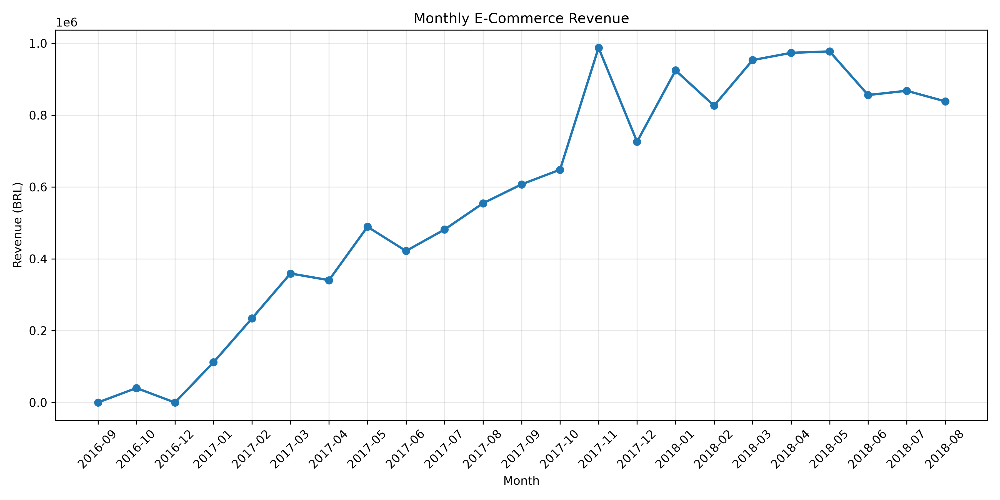
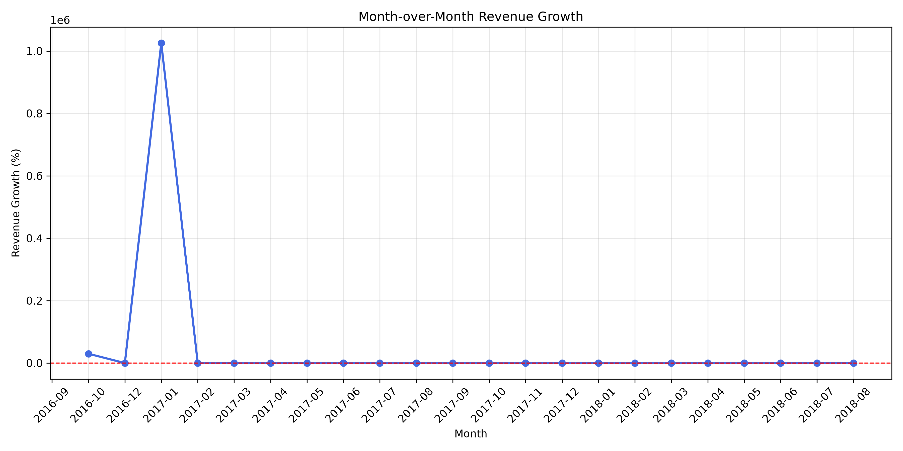
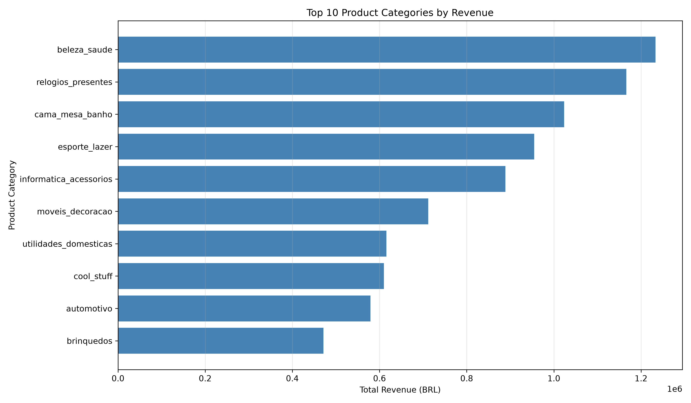
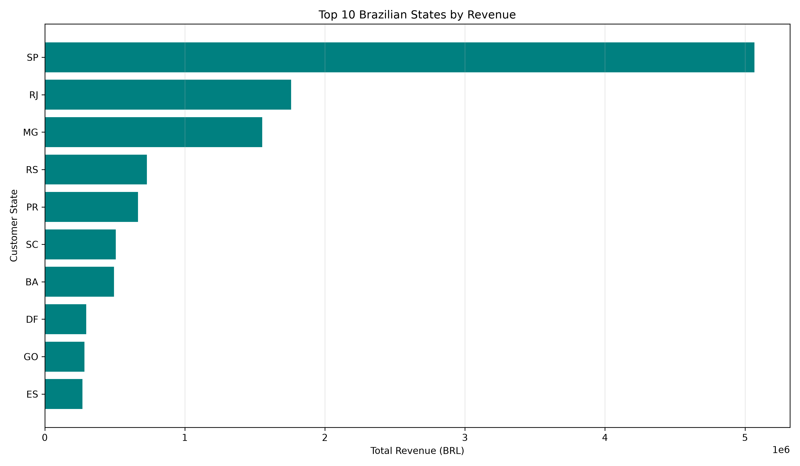
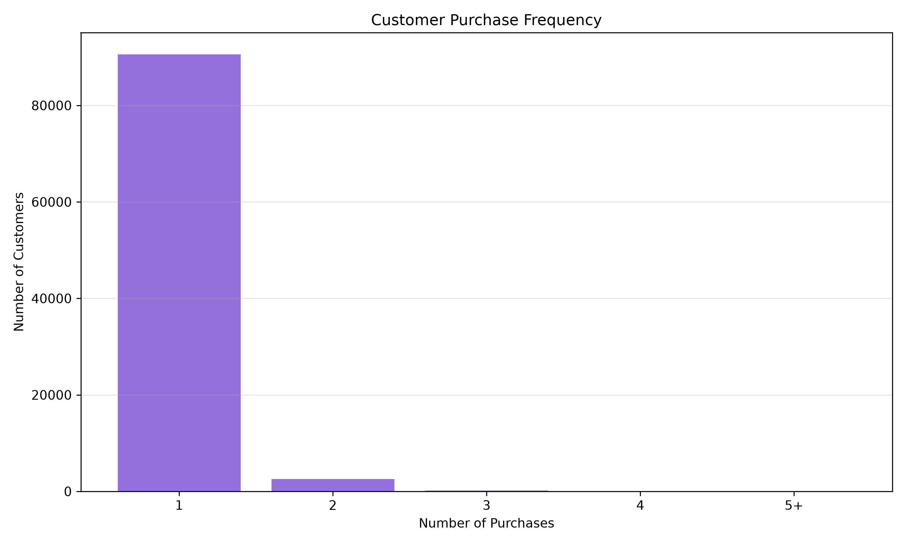
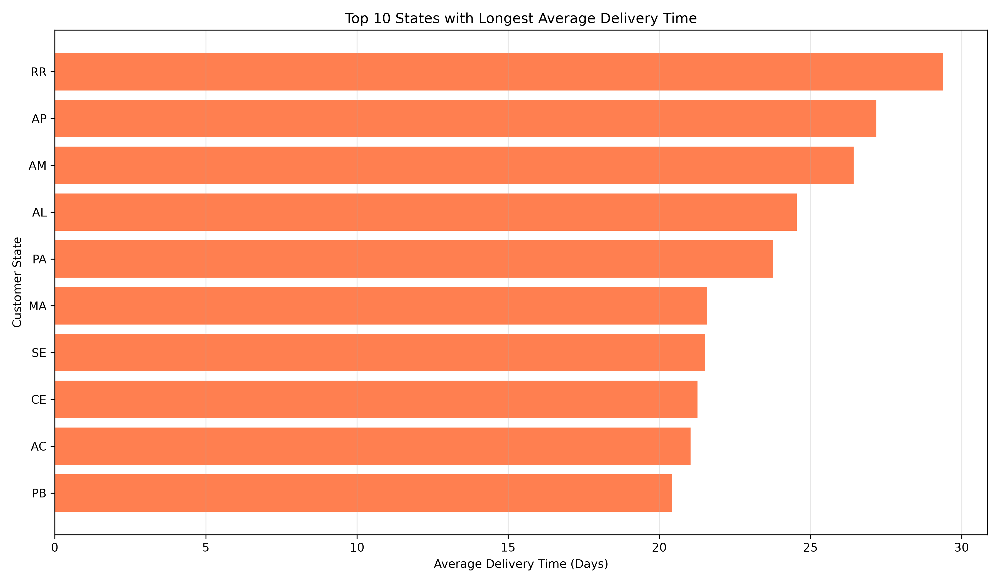
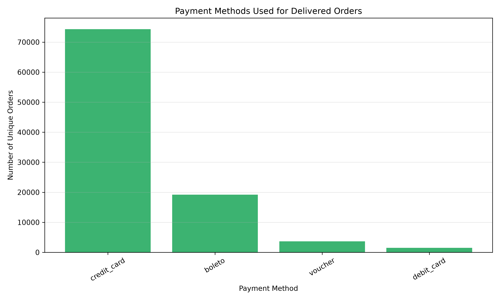

# 🛒 E-Commerce Sales Analytics Dashboard
**🚀 [Live Dashboard](https://ashiwany-ecommerce-dashboard.streamlit.app/)** | **💻 [GitHub Repository](https://github.com/Ashiwany25/E-Commerce-Sales-Analytics-Dashboard)**

An interactive Business Intelligence dashboard built using **Python, Pandas, Plotly, Streamlit, and MySQL** to analyze sales performance, customer behavior, product categories, regional revenue, and delivery operations.

The project uses the **Brazilian E-Commerce Public Dataset by Olist**, featuring approximately 100,000 customer orders.

## 📊 Project Overview

The goal of this project is to transform raw e-commerce transactional data into meaningful business insights through data cleaning, SQL analysis, exploratory data analysis, and interactive visualizations.

The dashboard enables users to monitor key performance indicators, explore sales trends, identify top-performing categories, evaluate customer purchasing patterns, and analyze delivery performance.

## ✨ Key Features

- **Interactive Dashboard:** Five navigation tabs covering business performance, products, regions, customers, and operations.
- **Business KPIs:** Total revenue, total orders, unique customers, average order value, and items sold.
- **Sales Analysis:** Monthly revenue trends and top-performing product categories.
- **Regional Analytics:** Revenue and order distribution across Brazilian states.
- **Customer Analytics:** One-time versus repeat customers and purchase frequency.
- **Delivery Analytics:** Average delivery duration, on-time deliveries, and late delivery rate.
- **Payment Analytics:** Payment method distribution and payment values.
- **Dynamic Filters:** Filter results by date range, customer state, and product category.
- **Automated Business Insights:** Data-driven summaries that respond to dashboard filters.
- **CSV Export:** Download filtered sales data and analytics reports.
- **Data Quality Monitoring:** Missing values, duplicate records, and dataset information.
- **Automated Testing:** Pytest unit tests for key analytics calculations.

## 🛠️ Technology Stack

| Technology | Purpose |
|---|---|
| Python | Data analysis and application development |
| Pandas & NumPy | Data cleaning and transformation |
| Plotly | Interactive visualizations |
| Streamlit | Web dashboard |
| MySQL | Database storage and SQL analysis |
| Matplotlib & Seaborn | Exploratory data analysis |
| Pytest | Automated unit testing |
| Git & GitHub | Version control |

## 📂 Project Structure

```text
E-commerce Sales Analytics Dashboard/
├── .streamlit/
│   └── config.toml
├── app.py
├── assets/
├── deployment_data/
│   ├── cleaned_ecommerce_data.csv
│   └── olist_order_payments_dataset.csv
├── src/
│   ├── explore_data.py
│   ├── merge_data.py
│   ├── data_cleaning.py
│   ├── validate_data.py
│   ├── eda.py
│   ├── import_to_mysql.py
│   └── import_payments.py
├── sql/
│   └── SQL business analysis queries
├── tests/
│   └── test_analytics.py
├── requirements.txt
├── .gitignore
└── README.md
```

## 📈 Dashboard Sections

### 1. Sales Overview
Displays overall business KPIs and monthly revenue performance.

### 2. Product Analytics
Identifies the highest-revenue product categories.

### 3. Regional Sales
Compares revenue and order volume across Brazilian states.

### 4. Customer Analytics
Analyzes customer purchase frequency and repeat purchasing behavior.

### 5. Operations Analytics
Examines delivery performance and payment method trends.

## 📸 Dashboard Visualizations

Explore the interactive dashboard: **[Live Demo](https://ashiwany-ecommerce-dashboard.streamlit.app/)**

### 📈 Monthly Revenue Trend


### 📊 Monthly Sales Growth


### 🛍️ Top 10 Product Categories


### 🌎 State-wise Revenue


### 👥 Customer Purchase Frequency


### 🚚 Delivery Performance


### 💳 Payment Methods


## 📊 Dataset

**Source:** [Brazilian E-Commerce Public Dataset by Olist — Kaggle](https://www.kaggle.com/datasets/olistbr/brazilian-ecommerce)

The dataset contains order, customer, product, payment, and delivery information from a Brazilian e-commerce marketplace.

**Data preparation:**
- Combined multiple relational CSV files.
- Filtered completed, delivered orders.
- Cleaned and validated key fields.
- Calculated revenue and delivery metrics.
- Prepared a consolidated dataset for dashboard analysis.

**Revenue definition:** Product sales value excluding freight charges.

## 🚀 Run Locally

### 1. Clone the repository

```bash
git clone https://github.com/Ashiwany25/E-Commerce-Sales-Analytics-Dashboard.git
cd E-Commerce-Sales-Analytics-Dashboard
```

Replace the placeholders with your actual GitHub repository details after publishing.

### 2. Create a virtual environment

```bash
python3 -m venv .venv
```

Activate it on macOS/Linux:

```bash
source .venv/bin/activate
```

On Windows:

```bash
.venv\Scripts\activate
```

### 3. Install dependencies

```bash
python -m pip install -r requirements.txt
```

### 4. Run the dashboard

```bash
python -m streamlit run app.py
```

Open the local address shown in the terminal, usually `http://localhost:8501`.

The dashboard uses the included deployment-ready CSV files, so a running MySQL server is not required to view it.

## 🧪 Automated Testing

Run the unit tests using:

```bash
python -m pytest tests/test_analytics.py -v
```

The tests cover revenue calculations, order counts, customer metrics, regional sales, and product category aggregations.

## 💡 Business Value

This project demonstrates how e-commerce transaction data can support decisions involving revenue growth, product performance, customer retention, regional opportunities, and delivery efficiency.

## 🔮 Future Improvements

- Sales forecasting using machine learning
- Customer segmentation using RFM analysis
- Advanced cohort and retention analysis
- Automated data pipeline scheduling
- Additional profitability and seller performance metrics

## 📄 License

The Olist dataset is sourced from Kaggle. Dataset usage remains subject to the source's applicable terms. No separate software license has been specified for this repository.
